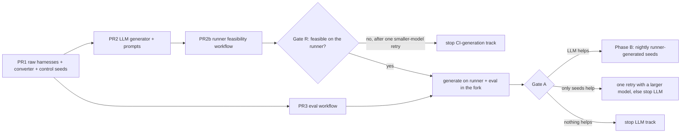

# Execution plan: local LLM seed generation for fuzzing

Status: approved for execution, PR by PR.

Phase A (PR1-PR3, PR2b, and the spike) is implemented and merged in a fork. If Gate A passes, PR1-PR3 and PR2b
are opened upstream unchanged, followed by PR4 onward. LLM seeds are generated on the runner at run time and are
never committed upstream. `tests/fuzz/llm/candidates/` exists only in the fork (fixed seeds for the controlled
experiment) and is never upstreamed.

## Goal

1. **Enable fast:** get a local LLM (llama.cpp, CPU only) generating fuzz seeds for two format-gated harnesses on a
   GitHub-hosted runner, with the fewest possible PRs. Prove runner feasibility (Gate R) before spending eval
   minutes.
2. **Assess:** run one controlled experiment that answers "does the LLM help, and is the gain from the LLM or just
   from having seeds?"
3. **Extend:** if it helps, generate seeds on the runner inside the scheduled fuzz workflow (seeds stay in
   artifacts, never in the repo), then roll it out harness by harness.

Everything before the assessment gate is a spike: keep it minimal and leave statistics and CI polish for later.

## Facts this plan relies on

- Every harness, including the "raw" modes, reads `FuzzedDataProvider` (FDP) selectors before the payload. Examples:
  `fuzz_shared_codec.test_one_input`, which picks a `mode` and then `max_bytes`/`max_depth`, and `fuzz_manifest`,
  which calls `ConsumeBool()` and then `ConsumeUnicodeNoSurrogates`. Seed bytes therefore cannot be written for
  the current harnesses without depending on how FDP lays out bytes internally.
- `fuzz_remote_images._raw_bytes_mode` builds its input from FDP. It never decodes raw bytes from the wire.
- Only `fuzz_manifest` has seeds (`tests/fuzz/seeds/fuzz_manifest/*.json`). They are plain JSON, which the
  current FDP harness mangles, but they can serve directly as the hand-written control for a harness that reads
  JSON verbatim.
- `tests/fuzz/test_seed_replay.py` replays **every** file in each `_HARNESS_SEEDS` directory, so only seed bytes
  may live there.

## Rules for the coding agent (all PRs)

- Do not change the behavior of existing harnesses. Add new harnesses instead.
- Workflows: pin every action by full SHA, set top-level `permissions: {}`, give jobs no permission beyond
  `contents: read`, set `persist-credentials: false`, use no secrets, never auto-commit, and do not interpolate
  `inputs.*` directly into `run:` (pass them through `env:`).
- Treat every corpus, artifact, and generated file as untrusted parser input. Never `eval` it, import it, or use
  it as configuration.
- Atheris runs on Linux only. Tests that import a harness run in CI on Linux.

### LLM-specific rules

- The LLM outputs **JSON only**. Deterministic converter code turns it into seed bytes. LLM output is never
  executed, imported, or committed without review. Generated seeds are not committed upstream; scheduled runs use
  them only from a workflow artifact.
- The converter enforces hard caps itself (nesting depth, decoded byte size, output length up to 64 KiB) and
  rejects input over a cap. It does not trust anything the LLM states about sizes.
- The model is local only: `llama-server` bound to `127.0.0.1`, with no API key, token, or other credential.
  The generator sends no `Authorization` header and rejects any `--endpoint` whose host is not a loopback
  address.
- The LLM never runs on `pull_request`. Before Phase B it runs in CI only in the manual `workflow_dispatch`
  workflow from PR2b, in the fork. From Phase B it also runs in the scheduled fuzz workflow (PR5).

## Metrics

| ID | Metric | Used in |
| --- | --- | --- |
| M1 | Final branch coverage (`coverage.py`, `branch = true`) of the target production modules, from replaying the final corpus. Also record the set of covered branch IDs | All gates |
| M2 | Unique crash signatures (exception type plus top in-repo frame) | All gates |
| M3 | LLM seeds added by `-merge=1` into a corpus that already holds the control seeds | Yield check |
| Y | JSON-valid rate, converter-accepted rate, and duplicate rate of LLM output | Yield check |
| R | On the hosted runner: tokens per second, seeds per minute, model load time, wall-clock, peak RSS of `llama-server`, and projected time for 200 seeds | Gate R |

- Each arm gets 10 trials of the same duration. Report the median and IQR, the Vargha-Delaney A12 effect size,
  and a two-sided Mann-Whitney U test. A12 of 0.64 or more counts as a "medium" effect.
- Before any decision, check noise: if the relative IQR of M1 in the `empty` arm is above 10%, rerun with
  20 trials.
- Deferred until after Gate A: time-to-branch metrics and named gates.

## Phase A: spike (enable and assess)



Sizes: S is under about 150 changed lines, M is about 150-500, L is over 500.

### PR1 - `test(fuzz): add raw-input harnesses, JSON-to-msgpack converter, and control seeds` (S)

- Add two harnesses that pass the input bytes verbatim, with no FDP, to the production entry point using
  production default limits. Reuse the allowed-exception tuples from the sibling harnesses.
  - `fuzz_manifest_json.py`: `Manifest.model_validate(json.loads(data))`, I-3. The LLM's JSON **is** the seed
    file, so no converter is needed.
  - `fuzz_remote_raw.py`: `decode_message`, `decode_predict_request` (including images), and
    `decode_predict_reply` on the same bytes, each in its own `try`, I-22 and I-24.
- Add `tests/fuzz/llm/to_msgpack.py`, a generic JSON-to-msgpack converter (`msgpack.packb(...,
  use_bin_type=True)`).
  - A JSON object of the form `{"$bytes": "<base64>"}` becomes a msgpack `bin` value. This covers `__np__` array
    data and JPEG payloads.
  - Caps: nesting depth a few levels above the codec's default maximum, so the depth gate stays reachable; at
    most 64 KiB of decoded bytes; output length at most 64 KiB. Input over a cap is rejected.
  - No per-harness types and no list of corruption kinds. Byte-level mutation is the fuzzer's job.
  - CLI: `to_msgpack.py <in_dir> <out_dir>` converts every `*.json` file and writes `<stem>.bin`. PR2 and PR3
    both use it.
- Control seeds (the hand-written baseline, also used as prompt examples in PR2):
  - `manifest_json` reuses `tests/fuzz/seeds/fuzz_manifest/*.json` unchanged.
  - `remote_raw` gets 3-5 hand-written JSON files in `tests/fuzz/llm/control/remote_raw/`: a minimal valid
    request, a request with one `__np__` input, a request with one JPEG image, and a valid reply.
- Tests: each harness accepts `b""`; every `remote_raw` control seed converts and decodes without error; the
  converter handles a small example correctly; the converter rejects input over each cap.
- Out of scope (moved to PR4, after Gate A): `fuzz.yml` matrix entries, `_HARNESS_SEEDS`, dictionaries.

### PR2 - `test(fuzz): add local LLM seed generator` (M; can be developed in parallel with PR3)

PR2 stays minimal: the generator, the prompts, and the metrics. The merge step is opt-in so the script runs anywhere.

- Add `tests/fuzz/llm/generate_seeds.py --harness {manifest_json,remote_raw} --count <n> --endpoint <url>
  --seed <int>`.
  - Calls the OpenAI-compatible `/v1/chat/completions` endpoint with `response_format: {"type": "json_object"}`.
    Each call asks for `{"seeds": [<json>, ...]}`.
  - Each seed is written as JSON bytes for `manifest_json`, or passed through `to_msgpack.py` for `remote_raw`.
    Rejected outputs are dropped. Seeds are deduplicated by SHA-256 and written to
    `tests/fuzz/llm/out/<harness>/`, which is git-ignored.
  - Always prints Y and writes `run.json` with the model file SHA-256 (when `--model-file` is given), prompt
    SHA-256, sampling parameters, seed, tokens per second, and seeds per minute.
  - The merge step is opt-in (`--merge`; Linux only, needs Atheris). It copies the control seed bytes into
    `out/<harness>/merged/`, runs `python <harness>.py -merge=1 out/<harness>/merged out/<harness>/raw`, moves the
    files that the merge added into `out/<harness>/added/`, and records M3 in stdout and `run.json`. Without
    `--merge`, generation runs on any OS and in the tests.
- Add `tests/fuzz/llm/prompts/<harness>.md` with:
  - the target function source and the relevant `I-n` invariants;
  - 2-3 example seeds taken from the PR1 control seeds, in JSON;
  - instructions to target boundaries: depth limit plus or minus 1, byte budget plus or minus 1, 0-d arrays,
    version and seq edge cases, truncated JPEG, mismatched image shapes, manifest shape and `n_obs_steps`
    extremes.
- Tests: use a fake endpoint to check that invalid JSON and over-cap output are rejected, that a non-loopback
  `--endpoint` is refused, and that `run.json` is written. No network access.
- Local run recipe, used for fast prompt iteration. Linux is needed for the `-merge` step. Fill in the `<...>`
  placeholders once, record them in `model.lock.toml` (PR2b), and use the same pinned model on the runner:

  ```bash
  # Reference model: Qwen3-4B-Instruct-2507 Q4_K_M (Apache-2.0), pinned GGUF repo and commit
  huggingface-cli download <gguf-repo> <file>.gguf --revision <commit> --local-dir models/
  sha256sum models/<file>.gguf
  llama-server -m models/<file>.gguf --host 127.0.0.1 --port 8080 -c 8192 -t "$(nproc)"
  uv run python tests/fuzz/llm/generate_seeds.py --harness remote_raw --count 200 \
    --endpoint http://127.0.0.1:8080 --seed 1 --merge --model-file models/<file>.gguf
  ```

### PR2b - `ci(fuzz): add manual runner feasibility check for the local LLM` (M; depends on PR1 and PR2)

Answers "can a GitHub-hosted runner run this model?" before any eval minutes are spent.

- Add `.github/workflows/fuzz-llm-generate.yml`, triggered only by `workflow_dispatch`. Inputs: `harness`
  (`manifest_json` or `remote_raw`), `count` (default 20), `seed`. Pass inputs through `env:`, never directly into
  `run:`.
- Pins live in `tests/fuzz/llm/model.lock.toml`: GGUF repo, commit, file name, and SHA-256; llama.cpp release tag,
  asset name, and SHA-256. The job checks both hashes before the first load or exec and fails on a mismatch. No
  token or secret is used; the model is public.
- Job on `ubuntu-latest`: top-level `permissions: {}`, job `contents: read`, `persist-credentials: false`, every
  action pinned by full SHA. Install the project and `atheris==3.1.0` as `fuzz.yml` does, start `llama-server`
  bound to `127.0.0.1`, wait for health, run `generate_seeds.py --merge --model-file ...`, and stop the server.
- Use `step-security/harden-runner` (SHA-pinned) with `egress-policy: audit`. The recorded egress list becomes
  PR5's block-mode allowlist.
- Write the R metrics to `$GITHUB_STEP_SUMMARY`, plus runner vCPU and RAM, Y, and M3. Upload `run.json` and
  `out/<harness>/` as artifacts. Treat the artifacts as untrusted data.
- Done when: a dispatch with `remote_raw` and `count=20` succeeds and the summary shows every R metric.

### PR3 - `ci(fuzz): add manual fuzz evaluation workflow` (M; parallel with PR2 and PR2b)

The full eval is not dispatched until Gate R passes.

- Add `.github/workflows/fuzz-eval.yml`, triggered only by `workflow_dispatch`. Inputs: `harnesses`, `arms`,
  `trials` (default 10), `duration_s` (default 600). The matrix is harness x arm x trial.
- Arms are defined in `tests/fuzz/eval/arms.toml`. No arm uses a dictionary, so the LLM is the only variable:
  - `empty`: no seeds.
  - `hand`: control seeds (`remote_raw` JSON is converted with the `to_msgpack.py` CLI first).
  - `hand_llm`: control seeds plus `tests/fuzz/llm/candidates/<harness>/`.
- Each trial job installs `atheris==3.1.0` and `coverage`, runs the harness with the `fuzz.yml` flags, then runs
  `tests/fuzz/tools/corpus_coverage.py`. That script replays the final corpus under `coverage.py` restricted to
  the target modules and writes M1 and the covered branch IDs as JSON. The job uploads that JSON, any crash
  files, and the fuzzer log.
- An aggregate job runs `tests/fuzz/tools/eval_report.py`. It computes A12 and Mann-Whitney U (stdlib only,
  unit-tested against known values), per-branch hit counts per arm, and M2 crash signatures from the fuzzer logs.
  It writes a Markdown table to `$GITHUB_STEP_SUMMARY`.
- Done when: a dispatch with 1 harness, 1 arm, and 2 trials succeeds.

### Running the spike

1. Dispatch PR2b with `count=20` for both harnesses and apply Gate R. Stop here if it fails.
2. Dispatch PR2b with `count=200` for both harnesses, so the candidates come from the model and runner that PR5
   would use. If Y or M3 fails the yield check below, iterate on the prompts locally with PR2's recipe and
   regenerate **before** spending eval minutes.
3. Download the `out/<harness>/added/` artifact (LLM seeds only, not the control copies) into
   `tests/fuzz/llm/candidates/<harness>/` and commit it in the fork.
4. Enable Actions in the fork, then dispatch `fuzz-eval.yml` with both harnesses, all three arms, and 10 trials
   of 600 s each. That is 60 jobs at about 13 minutes each (10 fuzzing plus setup and replay), about
   780 runner-minutes.

### Gate R: runner feasibility

Decided from the PR2b `count=20` runs, before the eval. The thresholds are starting values; adjust them once and
record the change here.

| Result | Condition | Decision |
| --- | --- | --- |
| Pass | For both harnesses: no OOM or timeout, model load plus generation finishes within 10 min, and the projected time for 200 seeds at the measured rate is at most 30 min per harness | Generate the 200-seed batch on the runner and continue to Gate A |
| Too slow | Only the time condition fails | Retry once with a smaller model (for example about 1.7B at Q4_K_M) and a smaller batch size. Re-measure and recheck Y |
| Infeasible | Still fails, or OOM | Stop the runner-generation track (skip PR5) and record it here. Whether to continue with seeds generated off-runner and kept in the fork only (Gate A) is a separate decision |

### Gate A: assessment

Compare `hand_llm` with `hand` to measure what the LLM adds. Compare `hand` with `empty` to measure what seeds add.

| Result | Condition | Decision |
| --- | --- | --- |
| Yield failure (checked before the eval run) | Converter-accepted rate below 90%, duplicate rate above 70%, or fewer than 3 merged LLM seeds per harness | Fix the prompts and regenerate. Don't run the eval yet. If the problem is structural garbage, add a per-harness JSON schema then |
| **LLM helps** | `hand_llm` vs `hand`: A12 of 0.64 or more and p < 0.05 on at least 1 harness, **or** at least 3 branches covered in 5 or more of 10 `hand_llm` trials and 0 of 10 `hand` trials, **or** an M2 crash signature found only in `hand_llm` | Upstream PR1-PR3 and PR2b, then go to Phase B (PR4, then PR5) |
| Seeds help, LLM doesn't | `hand` vs `empty` has A12 of 0.64 or more, but the LLM condition fails | Keep the hand seeds. Retry once with a larger model (for example a 7B coder model at Q4_K_M) and improved prompts. If it still fails, stop the LLM track |
| Nothing helps | `hand` vs `empty` has A12 below 0.64 | Stop the LLM track. Seeds don't matter for these harnesses |

Record the outcome, the model SHA, and the eval run URL in this file.

## Phase B: nightly runner-generated seeds (only after Gate A says "LLM helps" and Gate R passes)

LLM seeds are generated on the runner for each scheduled run and are never committed. They live in a workflow
artifact and in the matrix leg's working corpus. Hand seeds stay in the repo.

### PR4 - `test(fuzz): add accepted raw-input harnesses to the nightly fuzz run` (S)

- Add the accepted harnesses to the `fuzz.yml` matrix. They start from hand seeds only: `manifest_json` uses
  `tests/fuzz/seeds/fuzz_manifest` as its `seed_dir`; for `remote_raw`, a step converts
  `tests/fuzz/llm/control/remote_raw/*.json` with the `to_msgpack.py` CLI into the corpus directory, so no derived
  bytes are committed.
- Extend `_HARNESS_SEEDS` for `manifest_json` (its seeds are the existing `fuzz_manifest` files).
- No LLM seed is committed.

### PR5 - `ci(fuzz): generate LLM seeds in scheduled fuzz runs` (M)

- Precondition: Gate A says "LLM helps" and Gate R passes. A harness gets LLM seeds in the nightly run only if its
  own `hand` vs `hand_llm` eval meets the acceptance rule: A12 of 0.64 or more, a branch reached only by the LLM
  arm, or a new crash. Otherwise it runs with hand seeds only.
- Add one `generate` job that runs only on `schedule` and `workflow_dispatch`, with `contents: read` only. It
  generates `--count 200` seeds for each harness with LLM seeds enabled and uploads them as an artifact. The matrix
  legs download it and copy the seeds into their corpus after the hand seeds.
- Reuse PR2b's `model.lock.toml`, hash checks, and `llama-server` start steps (bound to `127.0.0.1`). Write no
  new download logic.
- Switch `step-security/harden-runner` from PR2b's `egress-policy: audit` to `block`, using the allowlist
  recorded in the PR2b audit runs (it includes the Hugging Face CDN hosts).
- Optionally cache the model with a key derived from its SHA-256, saved only from the default branch, and check
  the hash again after restore.
- Replay generated seeds with `-runs=0` in a separate step. Upload crashes as `llm-crash-*`. If generation fails,
  run with hand seeds only. Upload the LLM's JSON output, `run.json`, and the merged seeds as the audit artifact.
- A crash found on a generated seed is triaged through the process in `tests/fuzz/README.md`. A generated seed
  becomes a committed regression seed only through that manual corpus-review process, never automatically.

## Phase C: extend to more harnesses (after PR5 runs nightly)

Each new harness gets the same per-harness acceptance rule, comparing `hand` with `hand_llm` over 10 trials. For a
new harness, 2-3 hand-written JSON seeds are enough: they serve as prompt examples and as the control.

### PR6 - `test(fuzz): extend LLM seeds to remaining wire-format and string harnesses` (M)

- `fuzz_shared_codec_raw.py` (`unpack_msgpack(data)`, I-20) and `fuzz_transport_codec_raw.py` (the decode entry
  points on verbatim bytes, I-18). Both reuse `to_msgpack.py`.
- `fuzz_policy_name_raw.py` and `fuzz_import_dotted_path_raw.py`, which take UTF-8 bytes as the string (I-2,
  I-6). The LLM returns lists of strings.
- Add prompts, hand control seeds, fork-only candidates for the eval, and an eval dispatch for these harnesses.
  Enable LLM seeds in the nightly run only for harnesses that meet the acceptance rule.

### PR7 - `test(fuzz): add spec-input variants for FDP harnesses` (L)

This replaces the FDP inversion shim idea.

- For harnesses with no wire format, add a `fuzz_<name>_spec.py` whose input is a bounded msgpack map, decoded
  with `unpack_msgpack`. The map describes parameters: shapes, dtypes, special float values, modes, and op
  sequences. This applies to `component`, `stats_normalizer`, `resize_preprocessor`, `resize_smolvla`,
  `action_normalizer`, `action_chunk_trimmer`, `lerp_smoother`, `action_queue`, and `prepare_inputs`.
- The LLM writes the spec as JSON, and `to_msgpack.py` converts it. Keep the existing FDP harnesses unchanged:
  random mutation works well there, while spec variants carry the semantic seeds.
- Start with `component` (I-1 and I-5 boundaries), `stats_normalizer` (I-9), and `action_queue` (I-17). Add the
  others only if those three pass the acceptance rule.

## Effort summary

| PR | Phase | Size | Depends on | Eval runner-minutes (estimate) |
| --- | --- | --- | --- | --- |
| PR1 | A | S | - | - |
| PR2 | A | M | PR1 | - |
| PR2b | A | M | PR1, PR2 | about 30-60 (count 20, then count 200, for 2 harnesses; low confidence) |
| PR3 | A | M | PR1; full eval waits for Gate R | about 780 (Gate A) |
| PR4 | B | S | Gate A, Gate R, PR1-PR3 and PR2b upstream | - |
| PR5 | B | M | PR4, PR2b | about 30-60 per scheduled run (low confidence; depends on CPU token throughput) |
| PR6 | C | M | PR5 | about 1,040 (4 harnesses x 2 arms x 10 trials) |
| PR7 | C | L | PR5 | about 780 for the first 3 harnesses (3 x 2 arms x 10 trials) |

Tokens per second and seeds per minute on the runner come from the PR2b runs and size the PR5 time budget. Local
figures are only for prompt iteration, because runner CPUs are slower and have fewer cores.

## Expected outcome (prior, to be overturned by evidence)

- Runner throughput is the largest unknown. A 4B Q4 model on 2-4 CPU vCPUs may give only a few tokens per second,
  so Gate R may force a smaller model, and a smaller model lowers seed quality (watch Y).

- Seeds should clearly help `remote_raw` (version, seq, and nested images form a deep format gate). The LLM's
  margin over hand seeds is smaller on `manifest_json`, which already has four good hand seeds.
- The LLM's margin over hand seeds is uncertain. Its best chance is unusual combinations, such as a valid request
  with one image whose declared shape barely exceeds the byte budget.
- If Gate A passes on `remote_raw` only, enable it in PR4 and PR5, then start Phase C with PR7 (`component`,
  `stats_normalizer`), where semantic structure matters most.
